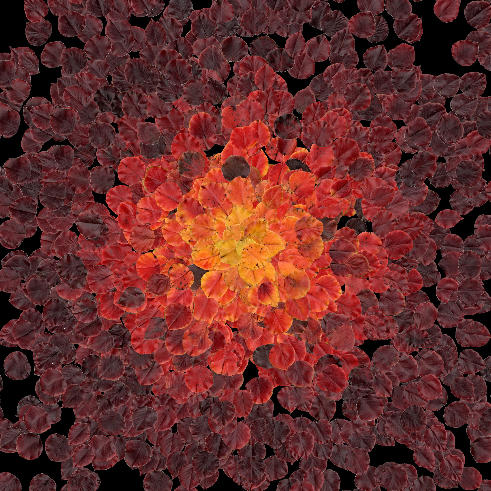

# LeafArt

I collected autumn leaves, scanned them at 1200 DPI, and wrote a computer-vision
pipeline that cuts each leaf out of the scans. The resulting 339 leaves power
a calm **falling-leaf screensaver** that runs in the browser, plus a
**radial colour mosaic**.

**[▶ Live screensaver](https://marissa-clark.github.io/LeafArt/)**



## What it does

```
57 scanned pages  ──extract──▶  individual leaves  ──triage──▶  clean leaves ──rotate──▶  339 upright leaves
                                                      │                                        │
                                           overlapping ▼                               ┌───────┴────────┐
                                             ──split──▶ back into the pool             ▼                ▼
                                                                                 screensaver      colour mosaic
```

| Stage | Technique |
| --- | --- |
| **Extract** | Otsu threshold (nudged up so pale yellow leaves still register), morphological clean-up, and **stem removal by shape**: a distance transform keeps only the thick part of each leaf, then grows it back by the same radius so thin stems never return. Contours become RGBA crops, and a saturation/brightness test removes the grey halo the scanner leaves along the edges. |
| **Triage** | Flags crops that aren't a single clean leaf by counting connected components, **distance-transform peaks** (two leaf centres in one blob), and deep **convexity defects** (the notches where two leaves overlap). Crops clipped by the page edge are discarded. |
| **Split** | Separates touching leaves with a **marker-based watershed** seeded from distance-transform peaks, falling back to a cut between clusters of concave contour points. |
| **Rotate** | Turns every leaf tip-up, using per-leaf angles from `data/leaf_rotations.csv`. |
| **Colour** | Measures each leaf's mean colour from its opaque pixels only, in HSL with hue wrapped so deep reds and purples sort together. |
| **Mosaic** | Ranks leaves by hue and maps rank to radius, so purple-red leaves sit on the rim and yellow ones at the centre. Copies are placed by rejection sampling so they don't stack, and each is turned to point away from the centre. |
| **Web export** | Trims and downsizes each leaf to a ~11 KB WebP sprite (3.9 MB for all 339) and writes a `leaves.json` manifest. |

## The screensaver

[`docs/index.html`](docs/index.html) is a single dependency-free page that
draws on a `<canvas>`. Each leaf gets a random depth that sets its size,
speed and opacity. Leaves sway and spin as they fall, and flatten as they
turn edge-on to fake a 3D flip. A slow, gusting wind pushes them all
sideways. Sprites load in the background, so the animation starts almost
immediately. The page respects `prefers-reduced-motion`.

**Keys:** `F` or double-click for fullscreen · `Space` pause · `↑`/`↓` more or fewer leaves · `H` hide hints

**URL options:** `?count=40`, `?speed=0.6`, `?size=1.4`, `?bg=light`, `?hint=0`, and
`?bg=transparent`, which makes the page easy to embed as a background:

```html
<iframe src="https://marissa-clark.github.io/LeafArt/?bg=transparent&hint=0&count=25"
        style="position:fixed; inset:0; width:100%; height:100%; border:0; pointer-events:none"></iframe>
```

Run it locally (it loads its sprites with `fetch`, so it needs a server rather than `file://`):

```bash
python -m http.server 8000 --directory docs
```

## Running the pipeline

```bash
pip install -r requirements.txt

python -m leafart extract          # data/scans/        -> data/leaves/
python -m leafart triage           # moves suspects to data/multiple_leaves/ and data/discarded_leaves/
python -m leafart split            # data/multiple_leaves/ -> data/leaves/
python -m leafart rotate           # data/leaves/ + data/leaf_rotations.csv -> data/rotated_leaves/
python -m leafart web              # data/rotated_leaves/ -> docs/leaves/ + docs/leaves.json
python -m leafart mosaic           # -> assets/mosaic.jpg
python -m leafart sheet data/leaves   # contact sheet for eyeballing any stage
```

`triage --dry-run` reports what would move without touching files. Tuning
constants live in a settings dataclass at the top of each stage module. Sizes
are in pixels and assume 1200 DPI scans.

The raw scans and full-resolution crops (~30 GB) are not in the repository;
only the rotation angles and the small web sprites are.

## Project layout

```
leafart/            Python package, one module per pipeline stage
  extract.py  triage.py  split.py  rotate.py
  color.py    mosaic.py  web.py    contact_sheet.py  cli.py
docs/               The screensaver (served by GitHub Pages)
  index.html  leaves.json  leaves/*.webp
assets/             README images
data/               Local only: scans and crops (git-ignored except leaf_rotations.csv)
```

## Built with

Python, OpenCV, NumPy, Pillow, and vanilla JavaScript / HTML canvas.

## License

[MIT](LICENSE)
